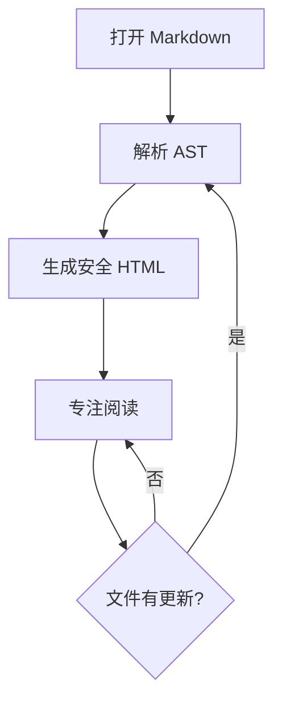

# Keen UI Walk 样本文档

这份文档用于持续验证 Keen 的阅读排版、导航和复杂内容渲染，不属于产品说明。

[打开产品需求](REQUIREMENTS.md) · [跳到 Mermaid](#4-mermaid)

## 1. 中文与英文混排

Keen 应让中文段落、English terminology 与 `inline code` 在同一行中保持舒适的字距、基线和阅读节奏。正文宽度不应随窗口无限增长。

> Reading First。界面应当安静、清晰，让内容成为注意力中心。

### 1.1 列表与任务

- [x] 文件树按需加载
- [x] 文档大纲
- [x] Mermaid 本地渲染
- [ ] 全文搜索

## 2. 表格

| 模块 | 当前状态 | 下一步 |
| --- | --- | --- |
| Reader | 可运行 | 优化排版 |
| Outline | 可运行 | 增加折叠 |
| Mermaid | 本地资源 | 压力测试 |

## 3. 代码

```swift
struct ReadingState: Codable {
    let headingID: String?
    let relativeOffset: Double
}
```

## 4. Mermaid



## 5. 长段落

当 Agent 在文档前部插入大量内容时，Keen 应优先根据当前章节锚点恢复位置，再使用段落标识和相对偏移量做降级，避免用户突然跳到文档顶部。外部更新不应抢夺键盘焦点，也不应造成明显白屏。
